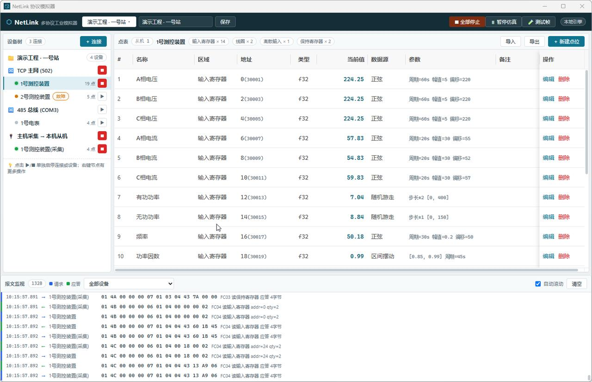
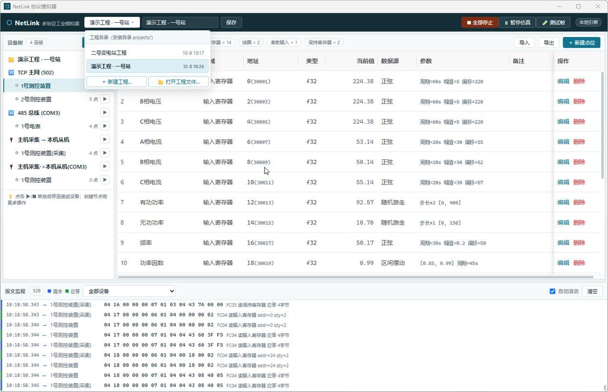
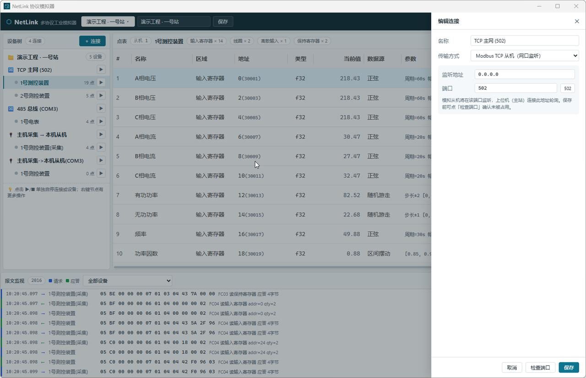
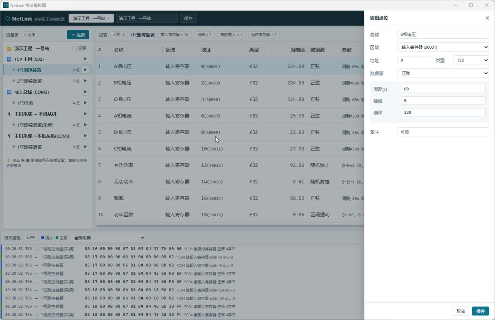
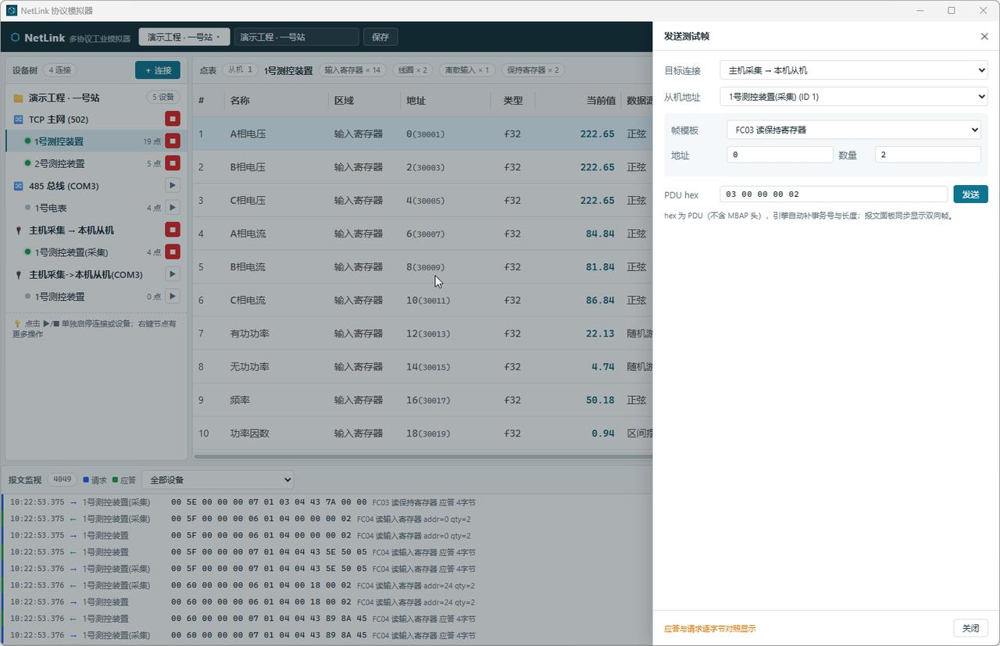

# NetLink 多协议工业模拟器

[](../../releases)
[](#下载与安装)
[](#技术栈)

NetLink 是一款面向电力/工业现场调试的**多协议主/从机模拟器**桌面工具：把你的点表配置成虚拟从机给主站采集调试，也可以反过来做虚拟主站去轮询、验证真实从机。仿真数据、报文监视、故障注入一站式完成，替代"找一台真实装置才能联调"的痛苦。



运行中的演示工程：左侧设备树（3 连接 / 4 设备），中间点表（实时仿真值），底部报文监视（Modbus 帧逐条解析）。

## 功能特性

### 协议模拟
- **Modbus TCP 从机**（网口监听）与 **Modbus RTU 从机**（真实串口 485）
- **Modbus TCP / RTU 主机**：主动连接/轮询远端从机，采集健康统计（最近成功/超时/失败计数 + 最近失败原因悬浮提示）；主机连接断开自动退避重连，设备树显示「连接中/重连中」徽章与断开原因
- 功能码 01/02/03/04/05/06/0F/10，四区（线圈/离散输入/保持寄存器/输入寄存器）全支持
- 主机侧可在线直写线圈/保持寄存器；「测试帧」面板支持发送任意十六进制 Modbus 帧

### 数据仿真
- 每个点位独立配置数据源：**静态值 / 正弦 / 斜坡 / 随机游走 / 区间摆动**
- 全局仿真时钟，支持一键暂停/继续

### 故障注入
- 设备级故障：**超时不响应 / 延迟响应 / 异常码应答**，加上 **脏帧（RTU 应答 CRC 破坏）** 与 **断连（TCP 收到请求即关闭连接）**，用于验证主站容错与重连逻辑

### 运行控制
- 逐连接、逐设备单独启停（设备树行内 ▶/■）；单台设备可脱离默认配置单独上线
- 运行中编辑连接/设备/点位自动重启对应连接，当前在线设备集合不丢失

### 工程管理
- 多工程管理：**新建 / 切换 / 打开任意位置的工程文件**，保存写回对应文件
- 工程保存在**安装目录的 `projects/` 文件夹**（不进 AppData，便于整体备份/迁移）；重启自动恢复上次打开的工程
- 首次运行自动把旧版 `%APPDATA%\NetLink\project.json` 迁移进工程目录

### 点表导入导出
- 设备点表一键导入/导出 **xlsx / CSV**（现场 Excel 点表直接变成仿真数据），导入前逐行预览校验，坏行不中断整批

## 界面一览

| 工程切换 | 连接编辑 |
|:---:|:---:|
|  |  |

| 点位编辑 | 测试帧 |
|:---:|:---:|
|  |  |

## 下载与安装

从 [Releases](https://github.com/coder-zhijiu/NetLink/releases/latest) 下载 v1.0.0：

| 文件 | 说明 |
|---|---|
| `NetLink_1.0.0_x64-setup.exe` | **NSIS 安装程序**（约 3.4 MB）——双击安装，含 WebView2 运行时引导、开始菜单/桌面快捷方式、卸载器；默认安装到当前用户目录，无需管理员权限 |
| `netlink-app.exe` | **绿色单文件**（约 13 MB）——前端已内置，系统装有 WebView2 即可直接运行；工程目录自动建在 exe 旁 |

系统要求：Windows 10 及以上（依赖 WebView2：Win11 自带；Win10 上安装包会自动引导安装）。

## 快速上手

1. **安装启动**：首次启动自动生成"演示工程 · 一号站"（含 TCP 主网、485 总线、主机采集三个连接），工程文件在安装目录 `projects\` 下。
2. **启动模拟**：在设备树点连接或设备行的 ▶。演示工程里的「主机采集 → 本机从机」连接会真实连上本机 502 端口的模拟从机——开箱即用的主从自测闭环。
3. **看数据**：点表"当前值"列实时刷新——从机模式为仿真值，主机模式为采集值（✎ 标记的值可点击直接写值下发）。
4. **看报文**：底部报文监视逐条显示 Modbus 帧（十六进制 + 功能码解析），支持按设备过滤、自动滚动。
5. **建自己的工程**：工具栏工程名旁 ▾ →「＋ 新建工程」→ 设备树「＋ 连接」选传输方式 → 加设备（从机地址、轮询周期）→ 手工加点位，或**直接导入 Excel 点表**。
6. **调试主站**：给工程加一个"Modbus TCP 主机"连接指向被测装置；或反过来让被测主站采集你的模拟从机，用故障注入考验它的容错能力。

### 点表文件列格式

导入/导出使用统一的 13 列格式（xlsx 取第一张工作表；CSV 为 UTF-8 带 BOM，Excel 直接打开不乱码）：

| 列 | 说明 | 示例 |
|---|---|---|
| 名称 | 点位名称 | A相电压 |
| 区域 | 线圈 / 离散输入 / 保持寄存器 / 输入寄存器（也接受英文枚举名） | 输入寄存器 |
| 地址 | 0 基十进制，0~65535 | 0 |
| 类型 | u16 / i16 / u32 / i32 / f32 / u64 / i64 / f64 | f32 |
| 数据源 | 静态 / 正弦 / 斜坡 / 随机游走 / 区间摆动 | 正弦 |
| 静态值 | 数据源=静态时使用 | |
| 周期(秒) | 正弦 / 区间摆动 | 60 |
| 幅值 / 偏移 | 正弦 | 5 / 220 |
| 步长 / 下限 / 上限 | 斜坡 / 随机游走 / 区间摆动 | |
| 备注 | 可选文本 | 进线 |

导入行为：参数列按数据源取用，空单元格用默认值；同设备内 (区域, 地址) 冲突的行自动跳过并计数；坏行逐行报告（不中断整批）；支持**追加**与**替换**两种模式；导入时连接若在运行会自动重启生效。

## 技术栈

- **桌面框架**：Tauri 2（WebView2 壳，安装包约 3.4 MB）
- **引擎**：Rust —— `netlink-core` 纯引擎库（不依赖 Tauri，可独立复用）：自研 Modbus TCP/RTU 协议栈、tokio 异步运行时、真实串口 IO
- **前端**：Vue 3 + TypeScript + Vite + vxe-table
- **文件解析**：calamine（xlsx 读）/ rust_xlsxwriter（xlsx 写）/ csv（带 BOM）
- **测试**：31 个 Rust 单元/集成测试覆盖协议行为、故障注入、采集可观测性、工程持久化与点表解析

## 从源码构建

环境要求：Node ≥ 20（含 pnpm）、Rust stable（MSVC 工具链）、Windows（WebView2）。

```bash
pnpm --dir web install

# 开发模式（热更新）
./web/node_modules/.bin/tauri dev

# 打安装包（产出 target/release/bundle/nsis/*.exe）
./web/node_modules/.bin/tauri build

# 跑测试
cargo test
```

> Windows CMD/PowerShell 下把 `./web/node_modules/.bin/tauri` 换成 `web\node_modules\.bin\tauri.cmd`。
> 纯前端浏览器演示模式（无需 Rust）：`pnpm --dir web dev` 后访问 http://localhost:5173 ，内置 mock 引擎可完整体验 UI。

## 项目结构

```
NetLink/
├── netlink-core/          # Rust 协议引擎（与 UI 无关）
│   └── src/
│       ├── model.rs       # 工程/连接/设备/点位领域模型 + JSON 持久化
│       ├── protocol/      # Modbus TCP/RTU 主/从机实现
│       ├── runtime.rs     # 运行时（仿真时钟、状态推送、连接任务）
│       ├── sim.rs         # 波形仿真
│       ├── check.rs       # 连通性/端口占用检测
│       └── sheet.rs       # 点表 CSV/xlsx 导入导出
├── netlink-app/           # Tauri 壳（命令层 + 工程文件管理）
├── web/                   # Vue 3 前端
│   └── src/
│       ├── store.ts       # 全局状态 + 工程管理动作
│       ├── api/           # contract / mock / tauri 双实现
│       └── components/    # 设备树 / 点表 / 报文监视 / 编辑器
└── doc/                   # 设计文档与截图
```

## 路线图

- [x] M1：Modbus TCP/RTU 主从模拟、故障注入、多工程管理、点表导入导出
- [x] M2：故障注入增强（RTU 脏帧 CRC 错误 / TCP 断连）
- [ ] M3：IEC 60870-5-104 被控站（手写 APDU/ASDU）
- [ ] M4：DL/T 645-2007 多功能电能表模拟 + 104 主站

## 文档

- [NetLink 多协议工业模拟器规划](doc/2026-10-08-NetLink多协议工业模拟器规划.md)
- [Modbus 主机模拟设计](doc/2026-10-08-Modbus主机模拟设计.md)
